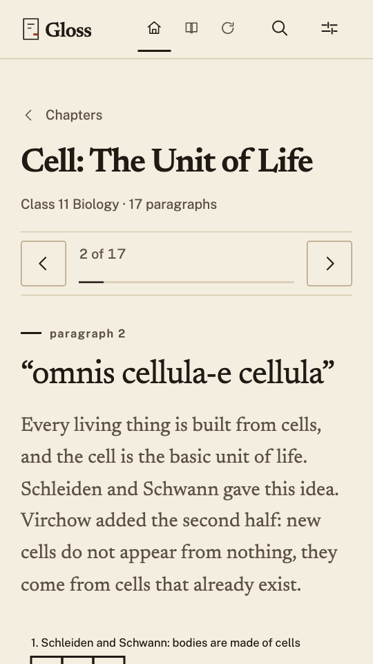
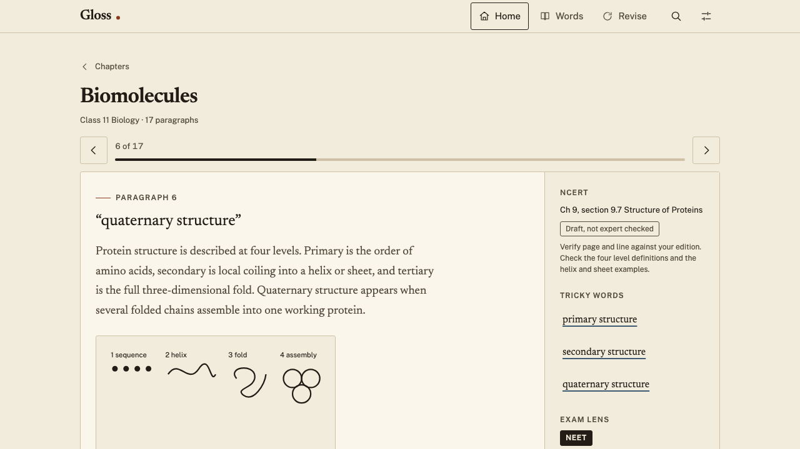

# Gloss

Margin notes for NCERT paragraphs. Gloss explains a textbook paragraph line by line, in the margin
beside it, for students preparing for NEET, JEE and UPSC. It works offline and keeps everything on
the device it runs on.





## Status

Usable for reading and revision, with two honest limits:

- **All content is draft.** 126 paragraphs across 24 chapters of Class 11 Physics, Chemistry and
  Biology have not been checked by a subject expert. The app says so on every card.
- **Page and line references are unverified.** They stay out until the exact NCERT edition is
  supplied. `npm run content:verify` reports SKIPPED until then.

There is no backend, no account and no telemetry. Chapter text never leaves the bundle; progress,
saved words and review dates live in `localStorage`.

## Features

- A reader built around one paragraph at a time: meaning, tricky words, exam lens, a diagram and a
  memory hook in the margin rail on tablet and desktop, stacked under the paragraph on a phone.
- 24 chapters split into 10 syllabus sections, loaded on demand one chunk per chapter.
- Four levels of page: library, subject, section, chapter, each with breadcrumbs and a next step.
- Spaced repetition on a day boundary (1, 3, 7, 21 days) with a revision screen that explains an
  empty day.
- Local search across paragraphs, tricky words and hooks.
- Export and import of all local data as validated JSON, with a migration from the 0.1 format.
- Settings for theme, text size, line spacing and exam goal, applied before first paint.
- Installable PWA with a hand-written service worker: visited chapters reopen with no network, and
  the update bar waits for a tap before reloading.
- Self-hosted fonts, a hand-drawn icon set, and a cool paper palette with one 3px radius.

## Stack

React 19, Vite 8, TypeScript 7, Zod 4. Content is JSON, validated against a schema in the build and
again when it loads. Hash routing, `localStorage`, an SVG allow-list renderer and a service worker
of about 100 lines. No UI framework, no CSS framework, no icon package.

## Quick start

```bash
npm ci
npm ci --prefix tools/lint   # lint has its own TypeScript 6 toolchain
npx playwright install chromium
npm run dev
```

| Command | What it does |
| --- | --- |
| `npm run dev` | dev server on 5173 |
| `npm test` | 49 unit tests |
| `npm run test:e2e` | 23 Playwright tests against a production build |
| `npm run lint` | ESLint with jsx-a11y and react-hooks |
| `npm run build` | content check, typecheck, bundle into `dist/` |
| `npm run content:check` | rebuild indexes and lint content |
| `npm run screenshots` | review shots at 360/390/768/1280, light and dark |
| `npm run lighthouse` | Lighthouse CI budgets (needs Chrome) |

## Measured, not claimed

From `npm run build` on 14 November 2026:

- Initial JavaScript: 383,424 B raw, **114,602 B gzip**, well inside the 200 kB budget.
- 24 chapters, 126 paragraphs, 10 sections, 120 review screenshots.
- Lighthouse was last run on 13 November 2026: 100 accessibility and best practices on Home, 96–97
  performance on the chapter route, CLS 0.000, LCP 2.6 s against a 2.5 s budget. It has not been
  re-run since the section pages landed, so treat those figures as historical. The full audit,
  including what was not tested, is in [`docs/AUDIT.md`](docs/AUDIT.md).

## Add a chapter

1. Copy `src/content/bio-11-ch8.json` to a new file in `src/content/`.
2. Change `id`, `subject`, `class`, `title` and fill `paragraphs`. Each paragraph needs two recall
   questions and a key phrase of 80 characters or less. Never paste NCERT text.
3. Keep SVGs to basic shapes, paths and text, coloured with `currentColor`. Only allow-listed tags
   and attributes are rendered.
4. Keep `review_status` as `draft` with a `review_note`. Run `npm run content:check` and
   `npm test`.

## Expert review

A paragraph becomes `expert_reviewed` only after a subject expert checks every fact, the page and
line reference against the current NCERT edition, and each recall answer. Record who reviewed it
and when in the pull request. Until then it stays draft. See
[`docs/SCIENCE-REVIEW.md`](docs/SCIENCE-REVIEW.md) and [`content/REVIEW.md`](content/REVIEW.md).

## Pages

| Route | Page |
| --- | --- |
| `#/` | landing: what Gloss is, three ways in, a sample paragraph |
| `#/library` | every chapter, by subject, plus what is not written |
| `#/s/Biology` | the subject's sections |
| `#/s/Biology/cell-structure-and-function` | the chapters of one section |
| `#/c/bio-11-ch8/cell-theory` | one paragraph and its margin note |
| `#/revise`, `#/words`, `#/search`, `#/settings` | revision, saved words, search, preferences |

## Security

`public/_headers` carries the CSP, `X-Content-Type-Options`, `Referrer-Policy`,
`Permissions-Policy`, HSTS and `frame-ancestors`. Netlify and Cloudflare Pages read this file;
GitHub Pages cannot set response headers, so use one of those hosts or a proxy. The CSP has no
`unsafe-inline`, so do not add inline scripts or styles. Content SVG is rebuilt from an allow-list
and never injected as HTML. Report problems as described in [`SECURITY.md`](SECURITY.md).

## Docs

- [`docs/RUNBOOK.md`](docs/RUNBOOK.md): setup, content pipeline, releasing, deploying, problems.
- [`docs/AUDIT.md`](docs/AUDIT.md): performance, accessibility and dependency audit.
- [`docs/PENTEST.md`](docs/PENTEST.md): the manual security pass and what it did not cover.
- [`docs/SECURITY-AUDIT-2026-11-14.md`](docs/SECURITY-AUDIT-2026-11-14.md): production-readiness
  audit with a status and a reason for every checklist item.
- [`docs/SCIENCE-REVIEW.md`](docs/SCIENCE-REVIEW.md): what draft means and how review works.
- [`docs/BRANCHING.md`](docs/BRANCHING.md): branches, commits, pull requests, releases.
- [`CONTRIBUTING.md`](CONTRIBUTING.md) and [`CHANGELOG.md`](CHANGELOG.md).
